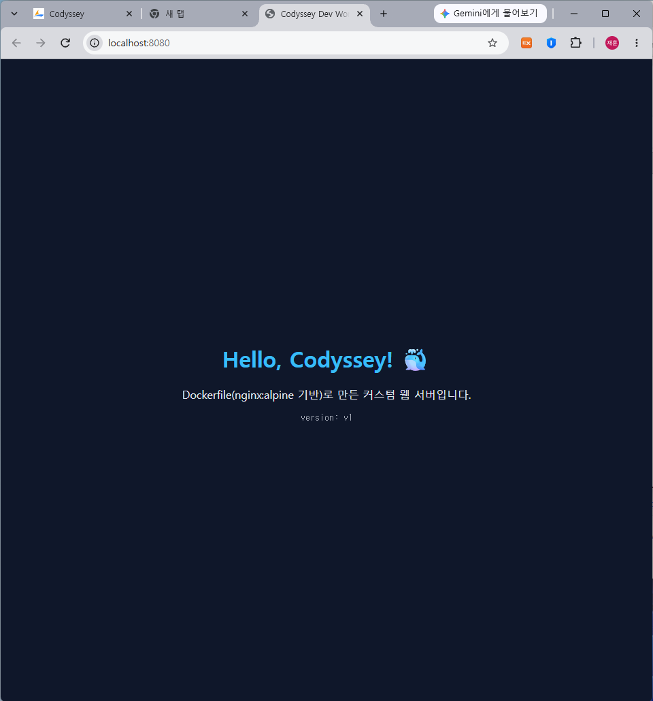
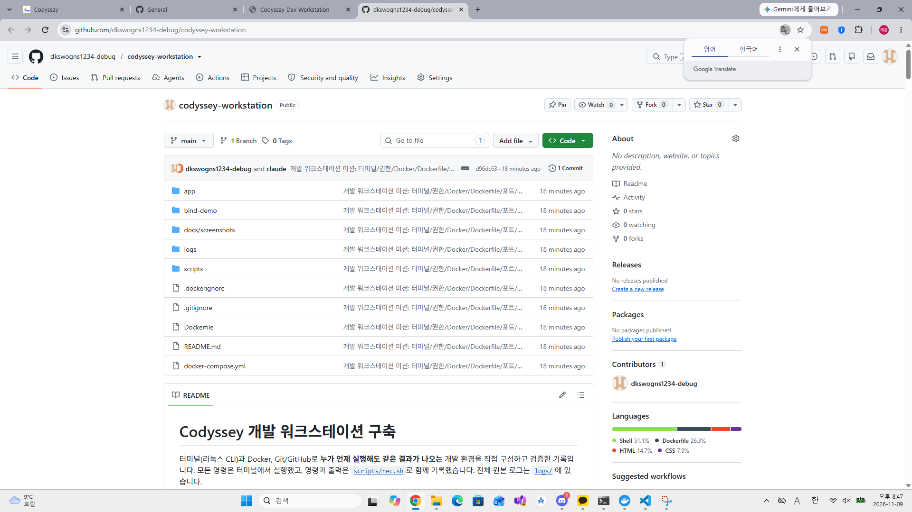

# Codyssey 개발 워크스테이션 구축

터미널(리눅스 CLI)과 Docker, Git/GitHub로 **누가 언제 실행해도 같은 결과가 나오는** 개발 환경을 직접 구성하고 검증한 기록입니다.
모든 명령은 터미널에서 실행했고, 명령과 출력은 [`scripts/rec.sh`](scripts/rec.sh)로 함께 기록했습니다. 전체 원본 로그는 [`logs/`](logs/)에 있습니다.

---

## 0. 프로젝트 개요

| 목표 | 수행 내용 | 검증 결과 |
|---|---|---|
| 터미널 기본 조작 | 경로 이동, 생성/복사/이동/삭제, 숨김 파일 확인 | [01_terminal.md](logs/01_terminal.md) |
| 파일 권한 | 파일 1개, 디렉토리 1개의 권한을 바꾸고 전/후 비교 | [02_permission.md](logs/02_permission.md) |
| Docker 설치·점검 | `docker --version`, `docker info`, hello-world, ubuntu 실행 | [03_docker_basic.md](logs/03_docker_basic.md) |
| 컨테이너 운영 | run/stop/start/rm, logs, stats, attach와 exec 비교 | [04_container_ops.md](logs/04_container_ops.md) |
| 커스텀 이미지 + 포트 매핑 | `nginx:alpine` 기반 Dockerfile 빌드, 8080/8081 접속 | [05_build_port.md](logs/05_build_port.md) |
| 바인드 마운트 / 볼륨 | 호스트 수정 즉시 반영, 컨테이너 삭제 후 데이터 유지 | [06_bind_volume.md](logs/06_bind_volume.md) |
| (보너스) Compose | 멀티 컨테이너, 서비스 이름으로 통신, 환경변수 주입 | [07_compose_bonus.md](logs/07_compose_bonus.md) |
| Git / GitHub | 사용자 정보·기본 브랜치 설정, VSCode에서 GitHub 연동 | [08_git.md](logs/08_git.md) |
| 포트 충돌 진단 | 충돌 재현 → 점유 주체 확인(`netstat`/`tasklist`, `ss`/`lsof`) → 해제 → 재시도 | [09_port_conflict.md](logs/09_port_conflict.md) |
| 보완 기록 | hello-world 직후 `ps -a`, `docker inspect` 요약, 이미지 vs 컨테이너 변경 실험 | [10_supplement.md](logs/10_supplement.md) |

## 1. 실행 환경

| 항목 | 값 |
|---|---|
| OS | Windows 11 Pro (build 26300) + WSL2 Ubuntu 26.04.1 LTS |
| 셸 / 터미널 | Git Bash(GNU bash 5.3.15, MSYS): Docker·Git 작업 / WSL bash 5.3.9: 터미널·권한 실습 |
| Docker | Docker Desktop: Client/Server 29.9.3 (WSL2 백엔드), Compose v5.7.0 |
| Git | 2.56.0.windows.4 |
| 에디터 | Visual Studio Code 1.144.1 |

> **재현 시 주의 (PC 종속 사항)**
> - 바인드 마운트 경로 `C:/Users/dkswo/Desktop/codyssey-workstation/bind-demo`는 이 PC 기준입니다. 다른 PC에서는 `"$(pwd)/bind-demo"`(macOS/Linux) 또는 `"${PWD}/bind-demo"`(PowerShell)로 바꿔서 실행하세요.
> - Git Bash에서 `docker -v`나 `wsl` 명령에 리눅스 경로를 넘길 때는 `export MSYS_NO_PATHCONV=1`을 먼저 실행하세요([트러블슈팅 3](#트러블슈팅-3--git-bash가-리눅스-경로를-윈도우-경로로-바꿔버림)).
> - macOS의 서울캠퍼스 환경에서는 Docker Desktop 대신 OrbStack을 실행하면 `docker` 명령을 똑같이 쓸 수 있습니다.

## 2. 수행 체크리스트

- [x] 터미널 기본 조작 및 폴더 구성 (pwd, ls -la, cd, mkdir, cp, mv, rm, cat, touch)
- [x] 권한 변경 실습 (파일 644→755→600→644, 디렉토리 755→700→644→755)
- [x] Docker 설치·점검 (`docker --version`, `docker info`)
- [x] hello-world 실행
- [x] ubuntu 컨테이너 내부 명령 실행, attach와 exec 차이 관찰
- [x] Docker 운영 명령 (images, ps, ps -a, logs, stats, stop, start, rm)
- [x] Dockerfile 커스텀 이미지 빌드·실행 (`codyssey-web:1.0`)
- [x] 포트 매핑 접속 2회 (8080, 8081)
- [x] 바인드 마운트 반영 (호스트 수정 → 재시작 없이 반영)
- [x] 볼륨 영속성 (컨테이너 삭제 후에도 데이터 유지, 대조군 포함)
- [x] Git 설정 (user.name / user.email / init.defaultBranch=main)
- [x] VSCode에서 GitHub 저장소 연동 (Publish Branch → Public 전환) → [증거](#9-git-설정-및-githubvscode-연동)
- [x] (보너스) Docker Compose 단일·멀티 컨테이너, up/down/ps/logs, 환경변수

## 3. 프로젝트 구조

```
codyssey-workstation/
├── README.md               # 기술 문서 (이 파일)
├── Dockerfile              # 직접 작성한 커스텀 nginx 이미지
├── docker-compose.yml      # 보너스: web + checker 멀티 컨테이너
├── app/
│   ├── site/               # 정적 웹 콘텐츠 (index.html, style.css)
│   └── conf/default.conf   # nginx 설정 템플릿 (/health, X-App-Env 헤더)
├── bind-demo/index.html    # 바인드 마운트 실습용 호스트 파일
├── scripts/
│   ├── rec.sh              # 명령과 출력을 로그 파일에 함께 기록하는 헬퍼
│   └── 01_terminal_perm.sh # 터미널·권한 실습 스크립트 (WSL에서 실행)
├── logs/                   # 단계별 전체 실행 로그 (01~10)
└── docs/screenshots/       # 브라우저 / VSCode 연동 스크린샷
```

| 폴더 | 넣는 것 | 넣지 않는 것 |
|---|---|---|
| `app/` | 이미지에 들어갈 웹 콘텐츠와 nginx 설정 | 로그, 문서 (`.dockerignore`로 빌드에서 제외) |
| `bind-demo/` | 바인드 마운트로 컨테이너에 연결할 호스트 파일 | 이미지에 굽는 파일 |
| `scripts/` | 실습을 다시 실행하거나 기록하는 셸 스크립트 | 비밀번호·토큰 등 비밀 값 |
| `logs/` | 명령과 출력을 그대로 남긴 실행 기록 (`rec.sh`로 생성) | 편집·요약한 결과 |
| `docs/screenshots/` | 브라우저·GitHub 화면 등 터미널 밖 증거 | 인증 코드·토큰이 보이는 화면 |

---

## 4. 터미널 조작 로그

WSL Ubuntu의 리눅스 파일시스템(`~/codyssey/practice`)에서 진행했습니다. 전체 로그: [logs/01_terminal.md](logs/01_terminal.md)

```bash
$ pwd                                   # 현재 위치 확인
/home/dkswo
$ mkdir -p ~/codyssey/practice          # 디렉토리 생성 (-p: 중간 경로까지 생성)
$ cd ~/codyssey/practice && pwd         # 이동
/home/dkswo/codyssey/practice
$ touch empty.txt                       # 빈 파일 생성
$ echo "hello codyssey" > memo.txt
$ mkdir docs
$ ls -la                                # 목록 확인 (숨김 파일 포함)
drwxr-xr-x 3 dkswo dkswo 4096 Nov  9 20:22 .
drwxr-xr-x 3 dkswo dkswo 4096 Nov  9 20:22 ..
drwxr-xr-x 2 dkswo dkswo 4096 Nov  9 20:22 docs
-rw-r--r-- 1 dkswo dkswo    0 Nov  9 20:22 empty.txt
-rw-r--r-- 1 dkswo dkswo   15 Nov  9 20:22 memo.txt
$ cat memo.txt                          # 파일 내용 확인
hello codyssey
$ wc -c empty.txt                       # 빈 파일인지 확인
0 empty.txt
$ cp memo.txt docs/memo_copy.txt        # 복사
$ mv empty.txt renamed.txt              # 이름 변경
$ mv renamed.txt docs/                  # 이동
$ rm docs/renamed.txt                   # 삭제
$ ls -la docs
-rw-r--r-- 1 dkswo dkswo   15 Nov  9 20:22 memo_copy.txt
$ echo ".hidden 파일" > .secret && ls && echo "--- ls -a ---" && ls -a
docs
memo.txt
--- ls -a ---
.
..
.secret        # ← -a 옵션을 줘야 점(.)으로 시작하는 숨김 파일이 보인다
docs
memo.txt
```

### 절대 경로와 상대 경로

```bash
$ cd docs && pwd && cd ..        # 상대 경로: 현재 위치 기준 (확인 후 practice로 복귀)
/home/dkswo/codyssey/practice/docs
$ cd ../practice/docs && pwd     # ..(상위)를 거쳐 같은 곳으로
/home/dkswo/codyssey/practice/docs
$ cd ~/codyssey/practice         # 절대 경로(~ = /home/dkswo): 어디서 실행해도 같은 곳
```

- **절대 경로**는 루트(`/`)에서 시작하는 전체 주소입니다(`/home/dkswo/codyssey/practice`). 현재 위치와 상관없이 항상 같은 대상을 가리켜서 스크립트나 설정 파일에 적합합니다.
- **상대 경로**는 현재 위치를 기준으로 합니다(`docs`, `../practice`). 짧게 쓸 수 있지만, 실행 위치가 바뀌면 다른 대상을 가리키거나 경로를 찾지 못할 수 있습니다.
- **사용 규칙**: 실행 위치가 매번 달라질 수 있는 것(cron, 다른 폴더에서 호출되는 스크립트, 시스템 설정)에는 **절대 경로**를 쓰고, 저장소 안 파일끼리 참조하는 것(README 링크, Dockerfile `COPY`, compose의 `build: .`)에는 **저장소 기준 상대 경로**를 씁니다. 그래야 다른 PC에 clone해도 그대로 동작합니다.

## 5. 권한 실습

전체 로그: [logs/02_permission.md](logs/02_permission.md)

**파일 (`perm_file.txt`)**: 변경 전과 후

```bash
$ stat -c "%A %a %n" perm_file.txt
-rw-r--r-- 644 perm_file.txt                 # 변경 전
$ chmod 755 perm_file.txt && ls -l perm_file.txt
-rwxr-xr-x 1 dkswo dkswo 5 Nov  9 20:22 perm_file.txt
$ chmod 600 perm_file.txt && ls -l perm_file.txt
-rw------- 1 dkswo dkswo 5 Nov  9 20:22 perm_file.txt
$ chmod u=rw,g=r,o=r perm_file.txt && stat -c "%A %a %n" perm_file.txt
-rw-r--r-- 644 perm_file.txt                 # 기호 방식으로 원복
```

**디렉토리 (`perm_dir`)**: 변경 전과 후, 실행 권한(x)을 뺐을 때의 동작

```bash
$ ls -ld perm_dir
drwxr-xr-x 2 dkswo dkswo 4096 Nov  9 20:22 perm_dir      # 변경 전 755
$ chmod 700 perm_dir && ls -ld perm_dir
drwx------ 2 dkswo dkswo 4096 Nov  9 20:22 perm_dir      # 소유자만 접근
$ chmod 644 perm_dir && ls -ld perm_dir
drw-r--r-- 2 dkswo dkswo 4096 Nov  9 20:22 perm_dir      # x 제거
$ cd perm_dir; echo "exit=$?"
cd: perm_dir: Permission denied
exit=1
$ ls -l perm_dir
-????????? ? ? ? ?            ? a.txt                     # 이름(r)은 보이지만 속성은 못 읽음
$ chmod 755 perm_dir && cd perm_dir && pwd
/home/dkswo/codyssey/practice/perm_dir                   # 원복 후 진입 성공
```

### 권한 표기 해석 규칙

- `-rwxr-xr-x`에서 첫 글자는 종류(`-` 파일, `d` 디렉토리)입니다. 나머지 9글자는 3글자씩 **소유자(u) / 그룹(g) / 기타(o)** 의 권한입니다.
- 숫자 표기는 각 자리마다 **r=4, w=2, x=1** 을 더한 값입니다.
  - `755` = 7(4+2+1 → rwx) / 5(4+1 → r-x) / 5(r-x): 소유자는 모두 가능하고 나머지는 읽기와 실행만 가능합니다. 실행 파일이나 공개 디렉토리에 씁니다.
  - `644` = 6(4+2 → rw-) / 4(r--) / 4(r--): 소유자만 수정할 수 있습니다. 일반 문서에 씁니다.
  - `600` = 소유자만 읽고 쓸 수 있습니다. SSH 개인키처럼 민감한 파일에 씁니다.
- 디렉토리에서는 의미가 다릅니다. **r**은 목록 보기, **w**는 안에서 생성·삭제, **x**는 진입(`cd`)과 안쪽 파일 접근입니다. 그래서 위 실험처럼 `644` 디렉토리는 이름만 보이고 들어갈 수 없습니다.
- **실습한 변경과 쓰임새**: `644→755`는 스크립트를 실행 가능하게 만들 때(`./run.sh`), `600`은 SSH 개인키·`.env`처럼 나만 읽어야 하는 파일, 디렉토리 `700`은 다른 사용자가 들어오면 안 되는 개인 폴더에 해당합니다.
- **특수 권한(참고)**: 앞자리에 붙는 setuid(`4xxx`, 실행 시 소유자 권한으로 동작, 예: `passwd`), setgid(`2xxx`), sticky bit(`1xxx`, 예: `/tmp`의 `drwxrwxrwt`, 남의 파일 삭제 금지)도 있습니다. 이번 실습 범위에서는 사용하지 않았습니다.

---

## 6. Docker 설치·점검 및 운영

전체 로그: [logs/03_docker_basic.md](logs/03_docker_basic.md), [logs/04_container_ops.md](logs/04_container_ops.md)

### 설치·데몬 점검

```bash
$ docker --version
Docker version 29.9.3, build 5457199

$ docker info | grep -E "Server Version|Operating System|OSType|Kernel Version|CPUs|Total Memory"
 Server Version: 29.9.3          # ← Server 정보가 나오면 데몬이 동작 중
 Kernel Version: 6.18.54.1-microsoft-standard-WSL2
 Operating System: Docker Desktop
 OSType: linux
 CPUs: 12
 Total Memory: 15.24GiB
```

### hello-world / 이미지 목록

```bash
$ docker run --name hello hello-world
Hello from Docker!
This message shows that your installation appears to be working correctly.
...
$ docker images
IMAGE                ID             DISK USAGE   CONTENT SIZE   EXTRA
hello-world:latest   c567b231f656       25.9kB         9.49kB   U
nginx:1.27-alpine    65645c7bb6a0       74.5MB         21.9MB
ubuntu:24.04         fe81560990fa        119MB         31.7MB
```

> **보완 (2026-11-14 18:16)**: hello-world 실행 직후 컨테이너가 어떻게 남는지 따로 확인했습니다. `/hello`를 실행하고 바로 `Exited (0)`로 끝난 컨테이너가 `ps -a`에 생성 시각과 함께 남습니다. [10_supplement.md](logs/10_supplement.md)
>
> ```
> CONTAINER ID   IMAGE         COMMAND    CREATED AT                      STATUS
> 2323ef8abc94   hello-world   "/hello"   2026-11-14 18:16:02 +0900 KST   Exited (0) Less than a second ago
> ```

### ubuntu 컨테이너 내부 진입 후 명령 실행

```bash
$ printf "hostname\nls /\necho hi from inside\nexit\n" | docker run -i --name shell ubuntu:24.04 bash
0acf5d448c4d                       # 컨테이너 ID가 곧 hostname (격리된 환경)
bin  boot  dev  etc  home  lib ... # 호스트(Windows)와 무관한 리눅스 파일시스템
hi from inside
$ docker ps -a --filter name=shell --format "{{.Names}} {{.Status}}"
shell Exited (0) Less than a second ago   # 메인 프로세스(bash)가 exit → 컨테이너 종료
```

> 대화형으로 직접 들어가려면 `docker run -it ubuntu:24.04 bash`를 쓰면 됩니다. 로그를 자동으로 남기려고 위에서는 표준입력으로 명령을 넘겼습니다.

### 운영 명령 (ps / logs / stats / stop / start)

```bash
$ docker run -d --name ubu ubuntu:24.04 bash -c "i=0; while true; do echo tick \$i; i=\$((i+1)); sleep 2; done"
$ docker logs --tail 3 ubu
tick 1
tick 2
tick 3
$ docker stats --no-stream ubu
CONTAINER ID   NAME   CPU %   MEM USAGE / LIMIT     MEM %   NET I/O         BLOCK I/O   PIDS
07ae4b8674ce   ubu    0.04%   2.164MiB / 15.24GiB   0.01%   1.17kB / 126B   0B / 0B     2
$ docker stop ubu
$ docker ps          # 실행 중인 것만 → 비어 있음
CONTAINER ID   IMAGE     COMMAND   CREATED   STATUS    PORTS     NAMES
$ docker ps -a       # 중지된 것까지 → Exited 상태로 남아 있음
07ae4b8674ce   ubuntu:24.04   "bash -c 'i=0; while…"   13 seconds ago   Exited (137) ...   ubu
$ docker start ubu && docker ps --format "{{.Names}} {{.Status}}"
ubu Up Less than a second
```

### attach와 exec의 차이 (관찰 결과)

```bash
$ docker exec ubu bash -c "echo 나는 exec로 띄운 새 프로세스; ps -ef"
UID   PID  PPID  CMD
root    1     0  bash -c i=0; while true; ...   # 메인 프로세스(PID 1)
root    8     0  ps -ef                          # exec가 새로 만든 프로세스
$ docker exec ubu bash -c "exit 0"; docker ps --filter name=ubu --format "{{.Names}} {{.Status}}"
ubu Up 1 second                                  # exec 셸이 끝나도 컨테이너는 그대로

$ timeout 5 docker attach ubu
tick 1
tick 2
tick 3                                           # 메인 프로세스의 출력 스트림에 붙음
```

| | `docker attach` | `docker exec` |
|---|---|---|
| 연결 대상 | 이미 돌고 있는 **메인 프로세스(PID 1)** 의 표준 입출력 | 컨테이너 안에 **새 프로세스**를 추가로 실행 |
| 빠져나갈 때 | 메인 셸에서 `exit`나 Ctrl+C를 누르면 **컨테이너가 종료**됨 (분리만 하려면 Ctrl+P, Ctrl+Q) | exec 프로세스만 끝나고 **컨테이너는 계속 실행** |
| 주 용도 | 메인 프로세스의 출력 보기 | 디버깅, 내부 점검 (`docker exec -it <이름> sh`) |

---

## 7. Dockerfile 커스텀 이미지 + 포트 매핑

전체 로그: [logs/05_build_port.md](logs/05_build_port.md)

### 선택한 베이스와 커스텀 포인트

**방식 (A)** 를 선택했습니다. 공식 웹 서버 이미지 **`nginx:1.27-alpine`** 을 베이스로, 정적 콘텐츠와 설정을 교체했습니다.

```dockerfile
FROM nginx:1.27-alpine
LABEL org.opencontainers.image.title="codyssey-web" \
      org.opencontainers.image.description="Codyssey dev workstation custom nginx"
ENV APP_ENV=dev
COPY app/conf/default.conf /etc/nginx/templates/default.conf.template
COPY app/site/ /usr/share/nginx/html/
HEALTHCHECK --interval=10s --timeout=3s --retries=3 \
  CMD wget -qO- http://127.0.0.1/health || exit 1
EXPOSE 80
```

| 커스텀 포인트 | 목적 |
|---|---|
| `FROM nginx:1.27-alpine` (태그 고정) | 가벼운 alpine 기반을 쓰고, 버전 태그를 지정해 베이스 이미지가 바뀌는 범위를 줄임 (완전히 같은 빌드를 보장하려면 `@sha256:` digest로 고정) |
| `LABEL` | 이미지의 이름과 용도를 메타데이터로 남겨 `docker inspect`로 확인할 수 있게 함 |
| `ENV APP_ENV=dev` | 실행 모드의 기본값. `docker run -e APP_ENV=prod`로 코드 수정 없이 바꿀 수 있음 (설정과 코드 분리) |
| 설정 템플릿 교체 (`templates/`) | nginx 공식 이미지의 envsubst 기능으로 `APP_ENV`를 응답 헤더 `X-App-Env`에 넣고, `/health` 엔드포인트 추가 |
| `COPY app/site/` | 기본 nginx 환영 페이지를 직접 만든 정적 페이지로 교체 |
| `HEALTHCHECK` | `/health` 응답으로 Docker가 컨테이너 상태(healthy/unhealthy)를 스스로 판단하게 함 |

### 빌드·실행 및 포트 매핑 접속 (2회)

```bash
$ docker build -t codyssey-web:1.0 .
#6 [2/3] COPY app/conf/default.conf /etc/nginx/templates/default.conf.template
#7 [3/3] COPY app/site/ /usr/share/nginx/html/
#8 naming to docker.io/library/codyssey-web:1.0 done

$ docker run -d -p 8080:80 --name web-8080 codyssey-web:1.0
$ docker run -d -p 8081:80 -e APP_ENV=prod --name web-8081 codyssey-web:1.0

$ docker ps --format "table {{.Names}}\t{{.Image}}\t{{.Status}}\t{{.Ports}}"
NAMES      IMAGE              STATUS                    PORTS
web-8081   codyssey-web:1.0   Up 12 seconds (healthy)   0.0.0.0:8081->80/tcp, [::]:8081->80/tcp
web-8080   codyssey-web:1.0   Up 13 seconds (healthy)   0.0.0.0:8080->80/tcp, [::]:8080->80/tcp

$ curl -sI http://localhost:8080 | grep -iE "^(HTTP|server|x-app-env)"
HTTP/1.1 200 OK
Server: nginx/1.27.5
X-App-Env: dev

$ curl -sI http://localhost:8081 | grep -iE "^(HTTP|server|x-app-env)"
HTTP/1.1 200 OK
Server: nginx/1.27.5
X-App-Env: prod                 # 같은 이미지에 환경변수만 다르게 줌

$ curl -s http://localhost:8081/health
ok

$ docker logs web-8080 2>&1 | tail -2
172.17.0.1 - - [09/Nov/2026:11:25:04 +0000] "GET / HTTP/1.1" 200 425 "-" "curl/8.23.0" "-"
```

**빌드 결과 식별 (`docker image inspect` 요약, 2026-11-14 재확인)** · [10_supplement.md](logs/10_supplement.md)

| 항목 | 값 |
|---|---|
| 태그 / 이미지 ID | `codyssey-web:1.0` / `sha256:50273fab5627…` |
| Env | `APP_ENV=dev` (베이스 이미지의 `NGINX_VERSION=1.27.5` 등과 함께) |
| ExposedPorts | `80/tcp` |
| Labels | `org.opencontainers.image.title=codyssey-web` |

**브라우저 접속 화면 (주소창 포함)**



### 포트 매핑이 필요한 이유

컨테이너는 자기만의 격리된 네트워크(예: `172.17.0.x`)를 가집니다. 그래서 nginx가 컨테이너 안에서 80번을 열어도 호스트에서는 바로 접근할 수 없습니다. `-p 8080:80`은 "호스트의 8080으로 들어온 요청을 컨테이너의 80으로 넘겨라"라는 연결 규칙입니다. 이 규칙 덕분에 **같은 이미지(컨테이너 내부 포트 80)를 호스트 포트만 바꿔서 여러 개** 띄울 수 있습니다(위의 8080과 8081).

```
  브라우저 / curl                    Docker Desktop                 컨테이너 (격리된 네트워크)
  localhost:8080  ──────────▶  호스트 8080 → 포트 포워딩  ──────────▶  web-8080  nginx :80
  localhost:8081  ──────────▶  호스트 8081 → 포트 포워딩  ──────────▶  web-8081  nginx :80
```

**접속이 안 될 때 점검 순서**

1. `docker ps` — 컨테이너가 `Up`인지, `PORTS`에 `0.0.0.0:8080->80/tcp`가 있는지
2. `docker logs web-8080` — nginx가 오류로 종료되지 않았는지
3. `curl -s -m 3 -I http://localhost:8080` — 시간 제한(`-m`)을 두고 응답 코드 확인 (제한이 없으면 기동 중에 응답을 무한정 기다릴 수 있음, 아래 로그 참고)
4. 실행 자체가 `port is already allocated`로 실패하면 → 아래 **포트 충돌 진단**
5. 급하면 다른 호스트 포트로 우회: `docker run -d -p 8090:80 ...` 후 `localhost:8090`

### 포트 충돌 진단과 해제

전체 로그: [logs/09_port_conflict.md](logs/09_port_conflict.md). 충돌을 일부러 만들고 실제로 진단·해제했습니다.

**A. 컨테이너끼리 같은 호스트 포트 (Windows + Git Bash)** · 로그 요약 발췌

```bash
$ docker run -d -p 8080:80 --name web-conflict codyssey-web:1.0    # web-8080이 이미 8080 사용 중
docker: Error response from daemon: ... Bind for 0.0.0.0:8080 failed: port is already allocated

$ docker ps --filter "publish=8080" --format "{{.Names}} -> {{.Ports}}"   # ① 어떤 컨테이너가 쓰는지
web-8080 -> 0.0.0.0:8080->80/tcp, [::]:8080->80/tcp

$ netstat -ano | grep -E "[:.]8080 .*LISTENING"                    # ② OS 수준에서 누가 LISTEN 중인지 (마지막 열 = PID)
  TCP    0.0.0.0:8080           0.0.0.0:0              LISTENING       24124
  TCP    127.0.0.1:8080         0.0.0.0:0              LISTENING       8908
$ tasklist /FI "PID eq 24124" /FO TABLE /NH                       # ③ PID → 프로그램 이름
com.docker.backend.exe       24124 Console                    1    163,344 K

$ docker rm web-conflict && docker stop web-8080                   # ④ 해제: 점유 컨테이너를 멈춤
$ docker run -d -p 8080:80 --name web-conflict codyssey-web:1.0    # ⑤ 재시도 → 성공
$ curl -s -m 3 -o /dev/null -w "%{http_code}\n" http://localhost:8080
200
```

> 점유 PID가 `com.docker.backend.exe`나 `wslrelay.exe`(Docker Desktop의 포트 전달 프로세스)라면 **프로세스를 kill하지 않습니다.** `com.docker.backend.exe`를 종료하면 Docker 엔진이 멈추고, `wslrelay.exe`를 종료하면 포트 전달이 끊길 수 있기 때문입니다. 대신 ①의 컨테이너를 `docker stop`/`docker rm` 하거나 다른 호스트 포트를 씁니다. `wslrelay.exe`의 `127.0.0.1:8080` 리스닝은 컨테이너를 지운 뒤에도 남아 있었지만, 같은 포트로 재실행해 HTTP 200을 확인하는 데는 문제가 없었습니다(로그 참고).

**B. Docker가 아닌 프로그램이 점유한 경우 → 프로세스 종료 (WSL Ubuntu, `ss`/`lsof`)** · 로그 요약 발췌

```bash
$ python3 -m http.server 8084 --bind 0.0.0.0 2>&1 | tail -1         # 이미 다른 python3가 8084 사용 중
OSError: [Errno 98] Address already in use

$ ss -ltnp "sport = :8084"                                         # ① 점유 프로세스 확인
LISTEN 0      5            0.0.0.0:8084      0.0.0.0:*    users:(("python3",pid=450,fd=3))
$ lsof -nP -iTCP:8084 -sTCP:LISTEN                                 # ② 같은 정보를 lsof로
python3 450 dkswo 3u  IPv4  20084      0t0  TCP *:8084 (LISTEN)

$ ps -o pid,cmd -p 450 && kill 450                                 # ③ 무엇인지 확인한 뒤 종료
    450 python3 -m http.server 8084 --bind 0.0.0.0
$ ss -ltn "sport = :8084" | tail -n +2 | grep -q . || echo "8084 LISTEN 없음 (해제됨)"
8084 LISTEN 없음 (해제됨)
재시도 → HTTP 200                                                   # ④ 다시 띄우니 정상
```

| 환경 | 점유 확인 | PID → 프로그램 | 해제 |
|---|---|---|---|
| Docker 컨테이너 | `docker ps --filter publish=8080` | (이름이 바로 나옴) | `docker stop <이름>` / `docker rm -f <이름>` |
| Windows | `netstat -ano \| findstr :8080` (PowerShell: `Get-NetTCPConnection -LocalPort 8080`) | `tasklist /FI "PID eq <PID>"` | `taskkill /PID <PID> /F` (Docker 프로세스 제외) |
| Linux / WSL | `ss -ltnp "sport = :8080"` 또는 `lsof -i :8080` | `ps -o pid,cmd -p <PID>` | `kill <PID>` (안 되면 `kill -9`) |
| macOS | `lsof -nP -iTCP:8080 -sTCP:LISTEN` | `ps -p <PID>` | `kill <PID>` |

> 참고: Windows에서 python을 `0.0.0.0:8083`에 먼저 띄운 뒤 Docker로 같은 포트를 publish했을 때는 **충돌 오류가 나지 않았습니다.** Windows 소켓 공유 동작 때문으로 보이며, 이 경우 어느 쪽이 응답할지 보장되지 않으므로 같은 포트를 겹쳐 쓰지 않도록 위 표로 먼저 확인합니다. 그래서 프로세스 종료 실습(B)은 같은 주소·포트에 공유 옵션 없이 바인딩하면 충돌이 그대로 재현되는 WSL Ubuntu에서 했습니다. ([09 로그 C](logs/09_port_conflict.md))

---

## 8. 바인드 마운트 반영과 볼륨 영속성

전체 로그: [logs/06_bind_volume.md](logs/06_bind_volume.md)

### 바인드 마운트: 호스트에서 바꾼 내용이 바로 반영됨

```bash
$ cat bind-demo/index.html
<h1>BIND v1 - 호스트에서 작성</h1>
$ docker run -d -p 8082:80 --name web-bind \
    -v "C:/Users/dkswo/Desktop/codyssey-workstation/bind-demo:/usr/share/nginx/html:ro" nginx:1.27-alpine
$ curl -s http://localhost:8082
<h1>BIND v1 - 호스트에서 작성</h1>                         # 변경 전

$ echo "<h1>BIND v2 - 호스트에서 수정함 (재빌드/재시작 없음)</h1>" > bind-demo/index.html
$ curl -s http://localhost:8082
<h1>BIND v2 - 호스트에서 수정함 (재빌드/재시작 없음)</h1>   # 변경 후: 즉시 반영

$ docker inspect web-bind --format "{{range .Mounts}}{{.Type}}: {{.Source}} -> {{.Destination}} (RW={{.RW}}){{end}}"
bind: C:/Users/dkswo/Desktop/codyssey-workstation/bind-demo -> /usr/share/nginx/html (RW=false)
```

### Docker 볼륨: 컨테이너를 지워도 데이터가 남음

```bash
$ docker volume create codyssey-data
$ docker volume inspect codyssey-data
        "Mountpoint": "/var/lib/docker/volumes/codyssey-data/_data",
        "Name": "codyssey-data",

$ docker run -d --name vol-test -v codyssey-data:/data ubuntu:24.04 sleep infinity
$ docker exec vol-test bash -c "echo \"persist me - \$(date -u +%FT%TZ)\" > /data/hello.txt && cat /data/hello.txt"
persist me - 2026-11-09T11:25:29Z           # 삭제 전

$ docker rm -f vol-test
$ docker ps -a --filter name=vol-test       # 컨테이너가 완전히 삭제됨
CONTAINER ID   IMAGE     COMMAND   CREATED   STATUS    PORTS     NAMES

$ docker run -d --name vol-test2 -v codyssey-data:/data ubuntu:24.04 sleep infinity
$ docker exec vol-test2 bash -c "ls -l /data && cat /data/hello.txt"
-rw-r--r-- 1 root root 34 Nov  9 11:25 hello.txt
persist me - 2026-11-09T11:25:29Z           # 삭제 후 새 컨테이너: 같은 데이터(타임스탬프 동일)
```

**대조군 (볼륨 없이 쓴 경우)**

```bash
$ docker run -d --name novol ubuntu:24.04 sleep infinity && docker exec novol bash -c "echo temp > /tmp/x.txt && cat /tmp/x.txt" && docker rm -f novol
temp
$ docker run --rm ubuntu:24.04 bash -c "cat /tmp/x.txt || echo 파일 없음"
cat: /tmp/x.txt: No such file or directory   # 컨테이너 레이어에만 쓴 데이터는 삭제와 함께 사라짐
```

### 정리: 이미지, 컨테이너, 저장소

- **이미지**는 읽기 전용 설계도이고, **컨테이너**는 그 위에 얇은 쓰기 레이어를 얹어 실행한 인스턴스입니다. 컨테이너를 지우면 쓰기 레이어도 같이 사라집니다(대조군).
- **바인드 마운트**는 호스트의 특정 폴더를 그대로 연결합니다. 개발 중에 소스를 수정하면 바로 반영해야 할 때 씁니다.
- **볼륨**은 Docker가 관리하는 저장소(`/var/lib/docker/volumes/...`)이고 컨테이너의 수명과 분리되어 있습니다. DB 데이터나 업로드 파일처럼 **컨테이너를 교체해도 유지해야 하는 데이터**에 씁니다.

| | 바인드 마운트 | 볼륨 |
|---|---|---|
| 저장 위치 | 내가 지정한 호스트 폴더 | Docker가 관리 (`/var/lib/docker/volumes/...`) |
| 장점 | 호스트에서 수정하면 즉시 반영, 파일을 바로 열어 볼 수 있음 | 호스트 경로와 무관해 이식성 좋음, 컨테이너 수명과 분리 |
| 단점 | 호스트 경로·OS(Windows 경로 표기)에 종속 | 호스트에서 파일을 바로 보기 불편 |
| 권장 | **개발**: 소스 코드·정적 파일을 고치며 확인할 때 | **운영**: DB 데이터·업로드 파일처럼 보존해야 할 데이터 |

**이미지 변경 vs 컨테이너 변경** ([10_supplement.md](logs/10_supplement.md)): 컨테이너 안에서 `docker exec`로 `index.html`을 `changed-in-container`로 바꿔도, 그 컨테이너를 지우고 같은 이미지로 새로 띄우면 원래 `<h1>Hello, Codyssey! 🐳</h1>`가 나옵니다. 변경은 그 컨테이너의 쓰기 레이어에만 있었기 때문입니다. 내용을 영구히 바꾸려면 `app/site/`를 고친 뒤 `docker build`로 **이미지를 다시 빌드**해야 합니다.

---

## 9. Git 설정 및 GitHub/VSCode 연동

전체 로그: [logs/08_git.md](logs/08_git.md)

```bash
$ git config --global init.defaultBranch main
$ git config --list --show-origin      # 이메일은 마스킹
file:C:/Users/dkswo/.gitconfig	user.name=dkswogns1234-debug
file:C:/Users/dkswo/.gitconfig	user.email=****@gmail.com
file:C:/Users/dkswo/.gitconfig	init.defaultbranch=main
file:C:/Users/dkswo/.gitconfig	core.autocrlf=input
$ git init
Initialized empty Git repository in C:/Users/dkswo/Desktop/codyssey-workstation/.git/
$ git branch --show-current
main
```

> 시스템 설정(`Program Files/Git/etc/gitconfig`)에는 `init.defaultbranch=master`가 있습니다. 하지만 사용자 설정(`~/.gitconfig`)이 우선 적용되므로 실제 기본 브랜치는 `main`입니다.

**GitHub 저장소 연동**

VSCode의 **Publish Branch**로 로컬 저장소를 GitHub에 올렸고, 이후 저장소를 공개로 전환했습니다.

```bash
$ git remote -v
origin	https://github.com/dkswogns1234-debug/codyssey-workstation.git (fetch)
origin	https://github.com/dkswogns1234-debug/codyssey-workstation.git (push)
$ git status -sb | head -1
## main...origin/main                  # 로컬 main과 원격 main이 동기화됨
$ curl -s -o /dev/null -w "%{http_code}\n" https://github.com/dkswogns1234-debug/codyssey-workstation
200                                    # 로그인 없이 접근 가능 (Public)
```



**커밋 → push 흐름 (이력)**

```bash
$ git add README.md
$ git commit -m "README 경로 예시 수정: 실습 로그와 같게 cd .. 추가"
$ git push origin main
To https://github.com/dkswogns1234-debug/codyssey-workstation.git
   3e7985d..e7fe77d  main -> main
$ git log --oneline
e7fe77d README 경로 예시 수정: 실습 로그와 같게 cd .. 추가
3e7985d 스크린샷(브라우저 접속, GitHub 저장소) 추가 및 GitHub 연동 기록
d96dc63 개발 워크스테이션 미션: 터미널/권한/Docker/Dockerfile/포트/마운트/볼륨/Compose 실습 및 기술 문서
```

위 출력은 2026-11-14 실제 터미널 실행 결과를 옮긴 것이며, 실행 후 이력은 [10 로그](logs/10_supplement.md)에 `git log`로 남겼습니다. 사전평가 보완 내용도 같은 흐름(`add → commit → push`)으로 반영합니다. 최신 이력은 저장소의 Commits 탭에서 확인할 수 있습니다.

### Git과 GitHub의 역할 차이

- **Git**은 내 PC에서 동작하는 **로컬 버전 관리 도구**입니다. 커밋, 브랜치, 이력 조회가 인터넷 없이도 됩니다.
- **GitHub**는 Git 저장소를 올려두는 **원격 협업 플랫폼**입니다. 백업, 공유, Pull Request 리뷰, 이슈 관리, CI/CD를 제공합니다.
- 둘은 `git push` / `git pull`로 연결됩니다. Git만으로도 버전 관리는 되지만, 다른 사람과 협업하려면 GitHub 같은 원격 저장소가 필요합니다.

---

## 10. (보너스) Docker Compose

전체 로그: [logs/07_compose_bonus.md](logs/07_compose_bonus.md) · 설정: [docker-compose.yml](docker-compose.yml)

```bash
$ docker compose up -d
 Network codyssey-workstation_default Created
 Volume codyssey-workstation_web-logs Created
 Container cw-web Started
 Container cw-checker Started
$ docker compose ps
NAME         IMAGE              SERVICE   STATUS                            PORTS
cw-checker   alpine:3.20        checker   Up 8 seconds
cw-web       codyssey-web:1.0   web       Up 9 seconds (health: starting)   0.0.0.0:8090->80/tcp
$ docker compose logs --tail 3 checker
cw-checker  | [checker] 11:25:55 ok          # checker가 서비스 이름 "web"으로 접근
$ docker compose exec checker wget -qO- http://web/ | grep h1
    <h1>Hello, Codyssey! 🐳</h1>              # 컨테이너 간 통신 성공 (서비스 디스커버리)
$ docker compose down

# 환경변수로 포트와 모드 변경 (설정과 코드 분리)
$ WEB_PORT=9090 APP_ENV=staging docker compose up -d web
$ curl -sI http://localhost:9090 | grep -iE "^(HTTP|x-app-env)"
HTTP/1.1 200 OK
X-App-Env: staging
$ docker compose down
```

- `docker run -d -p ... -e ... -v ...`처럼 길었던 실행 명령이 **YAML 파일로 문서화**되어, 누구든 `docker compose up` 한 줄로 같은 환경을 띄울 수 있습니다.
- Compose는 프로젝트 전용 네트워크를 만들고, **서비스 이름을 DNS 이름으로 등록**합니다. 그래서 IP를 몰라도 `http://web`으로 통신할 수 있습니다.
- 상태 확인 루틴: `up -d` → `ps`(상태와 헬스) → `logs`(동작) → `down`(정리)

---

## 11. 트러블슈팅

| 우선순위 | 증상 | 첫 확인 명령 | 예상 소요(경험 기준 추정) |
|---|---|---|---|
| 1 (모든 Docker 작업 차단) | `docker info` 연결 실패 | `docker info`, Docker Desktop 실행 여부 | 1~3분 (엔진 기동 대기) |
| 2 (실습 결과가 틀어짐) | Git Bash에서 `chmod` 미반영 | `uname -a`, `stat -c "%A %a"` | 5분 (WSL로 이동) |
| 2 | 경로 앞에 `C:/Program Files/Git` | 오류 메시지의 경로 확인 | 1분 (`MSYS_NO_PATHCONV=1`) |
| 2 | `port is already allocated` | `docker ps --filter publish=<포트>`, `netstat -ano` | 2~5분 (트러블슈팅 5) |
| 3 (기록만 불편) | `--format`의 `\n` 미해석 | 출력 확인 | 1분 (`grep`으로 대체) |

### 트러블슈팅 1 – Docker 데몬에 연결할 수 없음

- **문제**: `docker info`를 실행하면 Client 정보만 나오고, Server 항목에서 아래 오류가 발생했습니다.
  ```
  failed to connect to the docker API at npipe:////./pipe/dockerDesktopLinuxEngine;
  check if the path is correct and if the daemon is running
  ```
- **원인 가설**: `docker` CLI(클라이언트)는 설치되어 있지만, 실제로 컨테이너를 실행하는 데몬(Docker Desktop 엔진)이 켜져 있지 않다.
- **확인**: `docker --version`은 정상이었고(클라이언트만 확인하는 명령), 데몬과 통신하는 `docker ps`는 같은 오류로 실패했습니다. 오류 메시지의 named pipe(`dockerDesktopLinuxEngine`)가 없다는 것은 엔진 프로세스가 없다는 뜻입니다.
- **해결**: Docker Desktop을 실행하고 엔진이 뜰 때까지 `docker info`로 반복 확인한 뒤 진행했습니다. → `Server Version: 29.9.3`
- **배운 점**: Docker는 **클라이언트와 서버(데몬) 구조**입니다. `--version`이 된다고 Docker를 쓸 수 있는 상태는 아니고, 데몬 점검은 `docker info`로 해야 합니다.
- **다음에 같은 증상이면 (복구 순서)**: ① `docker info`로 Server 항목 확인 → ② Docker Desktop 실행(이미 켜져 있으면 트레이 메뉴 Restart) → ③ 30초 간격으로 `docker info` 재확인 → ④ 계속 실패하면 PowerShell에서 `wsl -l -v`로 `docker-desktop`이 `Running`인지 확인, 필요하면 `wsl --shutdown` 후 Docker Desktop 재실행 → ⑤ Docker Desktop의 Troubleshoot 메뉴에서 로그 확인. (2026-11-14 재점검 때도 ①에서 실패 → ② 실행 후 5초 간격 첫 확인에서 `29.9.3` 확인, [10 로그](logs/10_supplement.md))

### 트러블슈팅 2 – Git Bash에서 `chmod`가 적용되지 않음

- **문제**: Git Bash에서 `chmod 600`, `chmod 777`을 실행해도 `ls -l` 결과가 계속 `-rw-r--r--`로 똑같았습니다.
  ```
  $ chmod 600 t.txt; ls -l t.txt
  -rw-r--r-- 1 dkswo 197609 0 Nov  9 20:22 t.txt
  $ chmod 777 t.txt; ls -l t.txt
  -rw-r--r-- 1 dkswo 197609 0 Nov  9 20:22 t.txt
  ```
- **원인 가설**: 바탕화면은 Windows NTFS 파일시스템이라 리눅스식 rwx 권한 비트가 없다. Git Bash(MSYS)는 이를 흉내만 낸다.
- **확인**: `uname -a`가 `MINGW64_NT ... Msys`로 나와 진짜 리눅스가 아님을 확인했습니다.
- **해결**: 권한 실습은 **WSL2 Ubuntu의 리눅스 파일시스템(ext4, `~/codyssey/practice`)** 에서 진행했고, 644→755→600 변경이 정상적으로 반영됐습니다.
- **대안**: `docker run --rm -it ubuntu bash` 컨테이너 안에서 실습해도 됩니다. macOS는 기본적으로 POSIX 권한을 지원하므로 그대로 하면 됩니다.

### 트러블슈팅 3 – Git Bash가 리눅스 경로를 윈도우 경로로 바꿔버림

- **문제**: `wsl -d Ubuntu -- bash /mnt/c/Users/.../01_terminal_perm.sh`를 실행하자 아래 오류가 났습니다.
  ```
  bash: C:/Program Files/Git/mnt/c/Users/dkswo/Desktop/codyssey-workstation/scripts/01_terminal_perm.sh: No such file or directory
  ```
- **원인 가설**: 경로 앞에 `C:/Program Files/Git`이 붙어 있다. Git Bash(MSYS)가 `/`로 시작하는 인자를 Windows 경로로 자동 변환한 것 같다.
- **확인**: MSYS는 Windows 프로그램(`wsl.exe`, `docker.exe`)에 넘기는 POSIX 경로를 자동으로 변환합니다. `docker run -v /경로:/컨테이너경로`에서도 같은 문제가 생길 수 있습니다.
- **해결**: `MSYS_NO_PATHCONV=1`로 자동 변환을 끄고 다시 실행해서 성공했습니다. 이후 Docker 작업도 이 설정을 켠 상태로 진행했고, 바인드 마운트에는 `C:/...` 형식의 Windows 경로를 명시했습니다.

### 트러블슈팅 4 – `docker info --format`의 `\n`이 줄바꿈되지 않음

- **문제**: `--format "Server: {{.ServerVersion}}\nOS: ..."`처럼 쓰자 출력에 `\n`이 글자 그대로 찍혔습니다.
- **원인 및 확인**: Go 템플릿과 셸의 큰따옴표는 `\n`을 줄바꿈으로 해석하지 않습니다.
- **해결**: 전체 `docker info` 출력에서 `grep -E`로 필요한 줄만 골라 기록했습니다.

### 트러블슈팅 5 – `port is already allocated` (일부러 재현)

- **문제**: 이미 `web-8080`이 8080을 쓰는 상태에서 같은 포트로 컨테이너를 하나 더 실행하자 `Bind for 0.0.0.0:8080 failed: port is already allocated`가 발생했습니다.
- **원인 가설**: 같은 호스트 포트를 다른 컨테이너나 프로세스가 이미 점유하고 있다.
- **확인**: `docker ps --filter publish=8080`으로 `web-8080`을, `netstat -ano` + `tasklist`로 OS에서 LISTEN 중인 프로세스(`com.docker.backend.exe`)를 확인했습니다.
- **해결**: Docker 프로세스는 종료하지 않고 점유 컨테이너를 `docker stop` 한 뒤 재실행해 `200`을 확인했습니다. Docker가 아닌 프로그램이 점유한 경우는 WSL에서 `ss`/`lsof`로 PID를 찾아 `kill`로 해제했습니다. ([포트 충돌 진단과 해제](#포트-충돌-진단과-해제), [09 로그](logs/09_port_conflict.md))
- **배운 점**: 기동 직후 확인용 `curl`에는 `-m 3`처럼 시간 제한을 둡니다. 제한 없이 반복 대기하다가 응답을 무한정 기다리는 상황을 실제로 겪었습니다.

---

## 12. 검증 방법 요약

| 검증 대상 | 명령 | 확인한 내용 | 증거 |
|---|---|---|---|
| 숨김 파일 | `ls` vs `ls -a` | `.secret`이 `-a`에서만 보임 | [01](logs/01_terminal.md) |
| 권한 변경 | `chmod` + `ls -l` / `stat -c "%A %a"` | 전/후 권한 문자열·숫자 변화, x 제거 시 `cd` 거부 | [02](logs/02_permission.md) |
| 데몬 동작 | `docker info` | Server Version 출력 | [03](logs/03_docker_basic.md) |
| 컨테이너 수명 | `docker ps` vs `docker ps -a` | stop 후 ps에서는 사라지고 ps -a에는 Exited로 남음 | [04](logs/04_container_ops.md) |
| 이미지 커스텀 | `docker inspect` | LABEL, `APP_ENV=dev`, `80/tcp` 반영 | [05](logs/05_build_port.md) |
| 포트 매핑 | `curl -sI localhost:8080 / 8081` | 200 OK, `X-App-Env` dev/prod | [05](logs/05_build_port.md) + 스크린샷 |
| 헬스체크 | `docker ps` STATUS | `(healthy)` | [05](logs/05_build_port.md) |
| 바인드 마운트 | 호스트 파일 수정 후 `curl` | 재시작 없이 v1 → v2 | [06](logs/06_bind_volume.md) |
| 볼륨 영속성 | rm 후 새 컨테이너에서 `cat` | 같은 타임스탬프 데이터 유지 | [06](logs/06_bind_volume.md) |
| Git 설정 | `git config --list`, `git branch --show-current` | 기본 브랜치 main | [08](logs/08_git.md) |
| 포트 충돌 진단 | `docker ps --filter publish`, `netstat -ano`, `ss -ltnp`, `lsof` | 점유 주체 확인 → 해제 → 재시도 200 | [09](logs/09_port_conflict.md) |
| hello-world 직후 | `docker ps -a` | `/hello` 컨테이너가 `Exited (0)`로 남음 | [10](logs/10_supplement.md) |
| 이미지 식별 | `docker image inspect` | 태그·ID·Env·ExposedPorts·Labels | [10](logs/10_supplement.md) |
| 이미지 vs 컨테이너 | `docker exec`로 수정 후 새 컨테이너 | 수정은 사라지고 원본 유지 | [10](logs/10_supplement.md) |

## 13. 재현 방법

```bash
git clone <이 저장소 URL> && cd codyssey-workstation
docker build -t codyssey-web:1.0 .
docker run -d -p 8080:80 --name web-8080 codyssey-web:1.0
curl -i http://localhost:8080          # 또는 브라우저로 접속
# 정리
docker rm -f web-8080
# 보너스
docker compose up -d && docker compose ps && docker compose down
```

**환경별 주의 (바인드 마운트 경로 예시)**

| 환경 | 바인드 마운트 경로 쓰는 법 | 주의 |
|---|---|---|
| Windows · Git Bash | `-v "$(pwd -W)/bind-demo:/usr/share/nginx/html:ro"` | 먼저 `export MSYS_NO_PATHCONV=1` (경로 자동 변환 방지) |
| Windows · PowerShell | `-v "${PWD}/bind-demo:/usr/share/nginx/html:ro"` | `\` 대신 `/`를 써도 됨 |
| WSL Ubuntu | `-v "$(pwd)/bind-demo:/usr/share/nginx/html:ro"` | 프로젝트를 `/mnt/c`가 아닌 `~` 아래에 두면 파일 반영·권한이 정확 |
| macOS (OrbStack/Docker Desktop) | `-v "$(pwd)/bind-demo:/usr/share/nginx/html:ro"` | 포트 점유 확인은 `lsof -nP -iTCP:8080 -sTCP:LISTEN` |

## 14. 보안 및 개인정보

- 로그의 `user.email`은 `****@gmail.com`으로 마스킹했습니다. `git config --list` 기록에서는 `credential`/`token`이 들어간 줄을 제외했습니다.
- 토큰, 비밀번호, 개인키는 저장소에 넣지 않았습니다. `.env`는 `.gitignore`에 등록했습니다.
- 스크린샷에는 GitHub 계정 아이콘과 저장소 이름 외의 인증 정보(인증 코드, 토큰 창)가 보이지 않도록 촬영했습니다.
